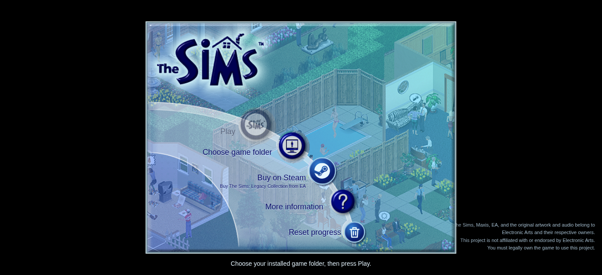
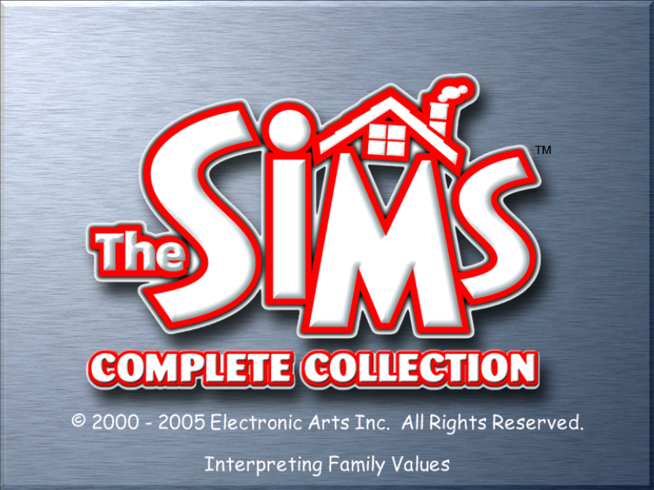
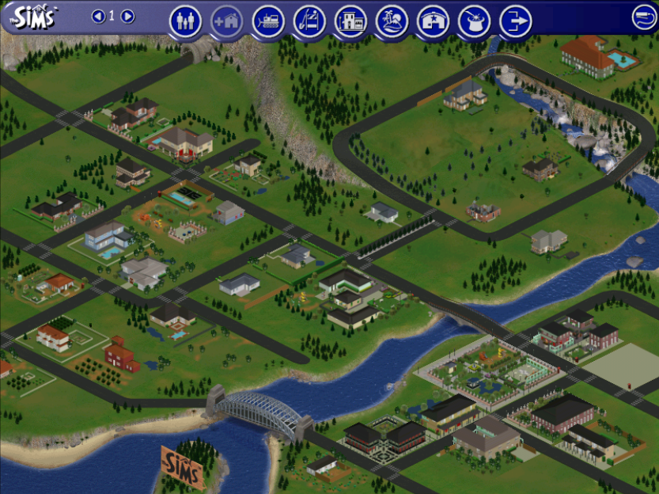
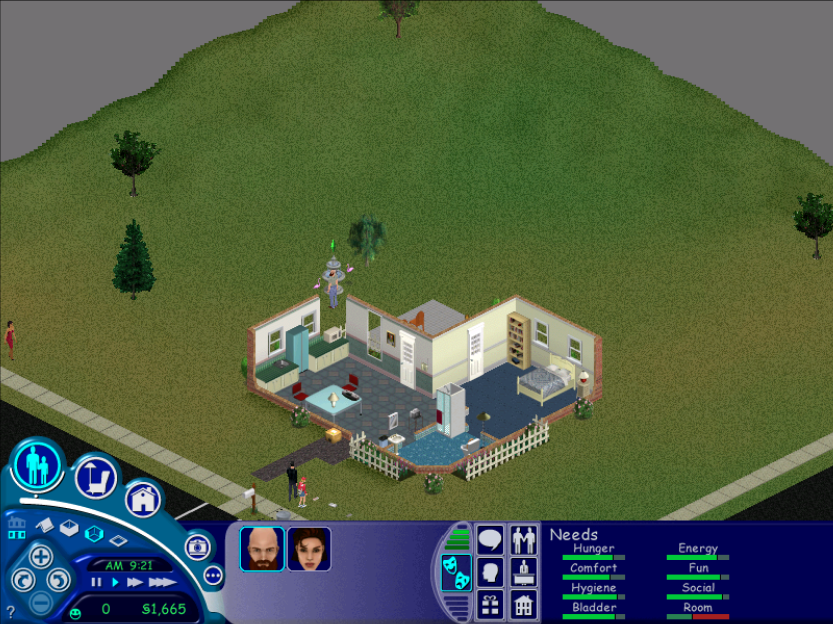

# The Sims 1 - The Complete Collection WASM Port

The original **The Sims - The Complete Collection**, running in a web browser through WebAssembly.

This project includes a Rust compiler that translates the original x86 game executable into WebAssembly, a Rust compatibility runtime, and a JavaScript browser host.

It's a work of love for The Sims community, made largely so I could play The Sims on an airplane with my iPad.

| Launcher | Loading |
| :---: | :---: |
| [](docs/screenshots/launcher.png) | [](docs/screenshots/loading.png) |
| **Neighborhood** | **Gameplay** |
| [](docs/screenshots/neighborhood.png) | [](docs/screenshots/gameplay.png) |

## Compatibility

You need to own a copy of **The Sims 1 - The Complete Collection (Version 1.91)** to use this port. The site does not distribute Sims.exe, game DLLs, game asset archives, or a precompiled game module. Your game files are read and compiled locally in your browser; they are not uploaded.

The launcher includes EA artwork and audio, and this README includes game screenshots. Those materials are separate from the project's source-code license.

The Sims: Legacy Collection and other executable builds are not supported.

The browser verifies the executable against the supported profile's SHA256. Select the full installation, including Sims.exe, gimex.dll, ijl10.dll, and all seven expansion archives. Intro movies are skipped automatically using the native `-skip_intro` argument, allowing startup when a movie is missing. Native saves remain in browser-local storage.

For the current Windows release, buy [The Sims: Legacy Collection on Steam](https://store.steampowered.com/app/3314060/The_Sims_Legacy_Collection/) from EA. That release is not supported by this port.

## Architecture

The website ships the Rust compiler and compatibility runtime as WebAssembly, along with the JavaScript browser host. A compilation worker translates the user's local executable and DLLs on the first launch. Later launches can reuse a browser-local cache, invalidated when the compiler or input binaries change.

The translated game runs in a separate execution worker. The compatibility runtime supplies the services it expects from Windows, while the browser host connects it to browser input, display, audio, and storage.

```text
Build time
  Rust compiler/runtime and browser host
                    |
                    v
       Compiler/runtime WebAssembly
                    |
                    v
       Static website (no game binaries)

Browser
       User's local executable and DLLs
                    |
                    v
       Rust compiler (compilation worker)
                    |
                    v
       Translated game WebAssembly
         (optional local cache)
                    |
                    v
       Game + compatibility runtime
           (execution worker)
                    |
                    v
       JavaScript browser host
          |         |         |
          v         v         v
     Display /    Selected   Browser-local
     input /      assets     saves (OPFS)
     audio
```

| Directory | Responsibility |
| --- | --- |
| `crates/compiler` | Load Windows PE binaries, decode x86 instructions, and emit WebAssembly. |
| `crates/runtime` | Provide guest memory, Windows API compatibility, graphics, audio, files, and registry services. |
| `crates/tools` | Build compiler/runtime bindings, run checks, package the site, and serve it locally. |
| `web` | Provide the launcher, worker lifecycle, browser integration, and persistent storage. |

## FAQ

### 1. Will you support The Sims: Legacy Collection?

No. I have no intention of getting into legal trouble with EA. If you really like The Sims 1, [buy it from them](https://store.steampowered.com/app/3314060/The_Sims_Legacy_Collection/). This is merely a work of love and a proof of concept to show what's possible, along with the goal of supporting the original **The Sims - The Complete Collection** software which is no longer sold/supported.

Apart from that, the Legacy introduces a Vulkan rendering layer that replaces the original(a good thing!) which would be more challenging as I'm more old school and outdated.

### 2. I found a bug!

There are still plenty of code paths the compiler hasn't covered yet. I'll probably fix those as I encounter them during my own gameplay. At this point, it's mostly translation work.

### 3. Does this use BoxedWine?

No! It translates the original game binary directly into WebAssembly. It's similar in spirit to [DiabloWeb](https://github.com/d07RiV/diabloweb), although DiabloWeb compiles reconstructed source code rather than translating the original binary.

Wine was used as a reference for implementing several of the Windows API calls.

### 4. Code could be better/performance could be better
Yeah... I tried my best but I did use a [clanker](https://en.wikipedia.org/wiki/Large_language_model) at the end of the day. Read the manifesto for a rant.

### 5. Where can I get a copy of The Sims - The Complete Collection?

Use your own lawfully obtained Complete Collection installation or physical discs. This project does not provide game downloads. A file being hosted in an archive is not evidence that its distribution is authorized.

### 6. My Complete Collection is not working, why?

The browser currently accepts one verified Complete Collection v1.91 executable, identified by its SHA256 in `crates/compiler/profiles/complete-collection.json`. A different patch or release can have a different hash and be rejected even if its version is also 1.91.

Supporting another executable requires a verified profile and compatibility testing. Some differences may also require compiler or runtime changes.

## License and credits

The project's source code is licensed under the [WTFPL](https://www.wtfpl.net/about/).

The Sims, Maxis, EA, and the original game code, artwork, and audio belong to Electronic Arts and their respective owners. The source-code license does not apply to those materials. This project is not affiliated with or endorsed by Electronic Arts.

## Manifesto of a broken man

The Sims 1 was my first ever purchased game, and it arguably shaped who I am as a person today.

I started early, with emulators (under the influence of my father), as we couldn't afford consoles (but we did have a Pentium 486!). That universe of emulation and code translation fascinated me as a kid.
During my early years and teenage years, I spent most of my time alongside computers, reverse-engineering everything I could find: games, binaries... decompiling... static analysis. For years, those were my greatest company.

Then, when the internet came (mind you, it came LATE in third world countries), I started participating in online communities, reverse engineering and developing emulators for famous games (MU, Ragnarok, Tibia and so on...) and I had a good run, altought I would rather keep those contributions anonymous.

For years, for most of my life, I dedicated myself to that: software. Understanding how machines work, creating works of love, optimizing every single bit so it could run even on a potato, so another little boy or girl like me could have access to games like I did. Computers were never cheap, at all.

I was fascinated by incredible people like [Andy Gavin (Crash Bandicoot)](https://all-things-andy-gavin.com/video-games/making-crash/), [Jamie Doornbos (The Sims)](https://archive.org/search?query=creator%3A%22Jamie+Doornbos%2C+Maxis%22) and so on. It was precise engineering, made with effort, love and desire, passion. Those things gave me the drive to be even close to those guys in skill level.

Eventually, that passion became a profession, which I am still exercising today, but with no more passion, no more desire.

This port of The Sims is an old dream. It goes back to when the web started to become more mature, new CSS/JS APIs spawned and browser games became possible (remember [BrowserQuest](https://en.wikipedia.org/wiki/BrowserQuest)?). However, it never bore fruit. Being an adult sucks, majorly. You have tons of responsibilities. It was no longer the hobby I could do in my teens/childhood for 8-14 hours a day.

I'm always happy with humanity's progress. It's inevitable; things change, sometimes for the best, other times for worse.

Time passed, and technology changed. Then AI came, and my work-life relationship changed. I realized that all the skills I took a lifetime to learn (and not even come close to mastering!) suddenly became a playground, nearly worthless and looked down on by investors, C-levels and everyone else. In mere months, the drive I had to write software, the desire to optimize every single bit like those early games: all that, gone.

One could argue that I could still try doing that, but, being honest, it would be impossible to do so with the current market. I have to put food on the table, and so does everyone. **Progress doesn’t wait, nor does it weigh personal opinions or nostalgia.**

So I decided to give it a shot: port that old dream of mine using the clankers. And so it began. Something that would've taken me 1-2 years to complete by myself suddenly came to life in 4 days.

AI still takes a lot of steering. Working through basic concepts and hallucinations, with a lot of information that I had in the back of my head, helped this project come to life. But at the end of the day, I don't expect this to become the norm or last for very long. 2 years ago, we had glorified AI autocompletes; today, I port a 2000 game in WASM; tomorrow, a model behaves and produces software like a human.

Make no mistake: while this was an old dream of mine, seeing my first ever purchased game running in a browser, I have no pleasure, no satisfaction, nor desire to say: "I did this! Look!".

And let's be honest: even if I had hand-written every single line here and published this today, no one would've believed I didn't use AI. At one moment in time a project like this would be commendable, it would ever open doors to hiring opportunities, now, it's just another Github repository.

It was a nice throwback, tho, looking at early concepts, the early Direct3D 7-8 APIs, WinAPI and even the early design documents from The Sims showing the incredible work those engineers did on things like [SimAntics](https://simstek.fandom.com/wiki/SimAntics), which was even taught at [universities](http://www.cs.northwestern.edu/~forbus/c95-gd/lectures/). It was even more amazing looking at more modern works from other amazing engineers like riperiperi's [FreeSO](https://github.com/riperiperi/FreeSO), which is arguably one of the most beautiful love declarations for a game that had so much potential.

I don't think that era or something close to that is ever coming back. We are never going back to writing incredibly optimized games. The attention to detail, the level of creativity: that is pretty much gone in the current state of the world, and it's about time I move on. This work is my final love letter to game development, emulation and reverse-engineering, even if it was made by clankers.

I do wonder if I should've spent more time outside being a [teen idle](https://www.youtube.com/watch?v=Ie0Ub3-Dx8Y) instead. I honestly can't wait to become a [goose farmer](https://web.archive.org/web/20240502024534/https://www.timesnownews.com/business-economy/industry/worked-in-microsoft-for-22-years-now-a-goose-farmer-linkedin-profile-goes-viral-on-social-media-article-109754966).

It's even ironic, me reminiscing, complaining about AI, with a game that simulated life(and has tons of AI inside it's code).

This work is a love letter to the first game I ever purchased. The game I spent thousands of hours with, whose little CD I shared with my cousins, which drove me ahead, with it's pixels, to have the good life I have today because I wanted a house like that, with the expensive jacuzzi.

Thank you, The Sims.
